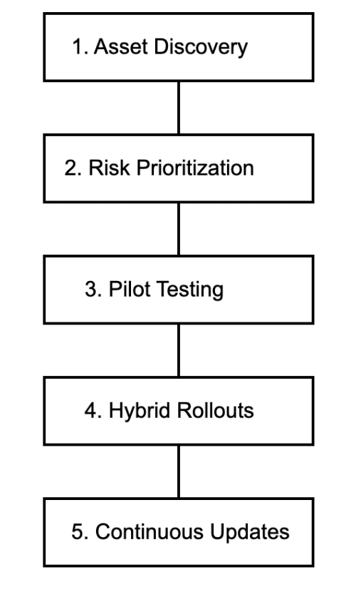

# Post-Quantum Cryptography and Adoption Challenges

**Shreya Gajjar | Wright State University**

This research project looks at how organizations can prepare to use post-quantum cryptography. I reviewed the main algorithm families and the practical problems involved in moving from existing cryptographic systems.

**Course:** CEG-6422, Secure Computing Practices  
**Report date:** December 13, 2025  
**Status:** Research report completed. Implementation code will be added later.

## What I studied

- The risk quantum computing poses to RSA and elliptic-curve cryptography.
- Key exchange and digital signature options discussed in the literature.
- Differences in key sizes, signatures, and processing needs.
- Compatibility with existing systems and devices.
- Migration planning, staff skills, and cryptographic agility.

The paper discusses Kyber, Dilithium, Falcon, SPHINCS+, and Classic McEliece. These are the names used in the original report.

## Main finding

Choosing an algorithm is only one part of the work. Organizations also need to know where cryptography is used, which data needs long-term protection, and how changes will affect their systems. Small pilot tests can help identify problems before a wider rollout.

## Migration framework

The report organizes migration into five steps: discover assets, prioritize risks, run pilot tests, introduce hybrid deployments, and keep updating the system.

## Planned implementation

I plan to add a small comparison of classical and post-quantum cryptography. It will record key sizes, operation times, and the test environment. I will add the code and measured results once that work is implemented.

This repository currently contains research notes and a figure, not a working cryptographic library or completed benchmark.

[Research notes](docs/RESEARCH.md) · [Report and figure sources](docs/SOURCES.md)
